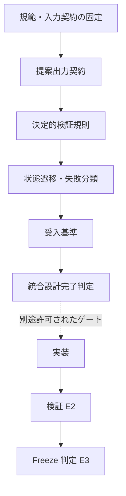
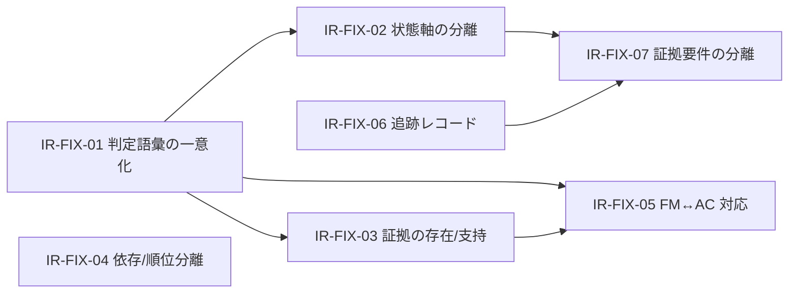

# Step 12 — 統合設計レビュー（Integrated Design Review）

**Contract ID:** `IR`
**Version:** `0.1.0-draft`
**Status:** `REVIEW DRAFTED / NOT FROZEN`
**Phase:** `DESIGN ONLY`
**Mutation policy:** `NO_MUTATION`（実ファイル照合・編集、Validator 実行、テスト、Freeze は GATED）
**Review input:** これまでの会話に記録された設計案（Step 7〜11）のみ
**Explicitly out of scope:** 実ファイルの内容、実装の適合性、Step 7〜9 成果物の実在

---

## 0. レビュー方法と結論の限界

### 0.1 方法

- 対象は会話に記録された設計案（規範案・契約案・状態案・受入基準案）のみ。
- 照合次元: ①用語の重複と衝突 ②状態遷移の欠落 ③証拠契約の不備 ④完了条件の循環依存 ⑤責務の混同 ⑥追跡可能性。
- 判定は `整合` / `部分整合` / `要補強` / `欠落` の 4 値。

### 0.2 このレビューが導かない結論

- 実装上の欠陥が実在するという結論（実ファイル未照合）。
- 受入基準が満たされているという結論（テスト未実行）。
- 補正候補が採択済み規範であるという結論（**本レビューの全補正は `PROPOSED / NOT ADOPTED`**）。
- Step 7〜9 の成果物が会話記録と一致しているという結論（未確認）。

---

## 1. 統合レビュー結果 IR-01〜IR-09

| ID | 監査対象 | 判定 | 指摘 | 影響する契約 | 対応補正 |
| --- | --- | --- | --- | --- | --- |
| IR-01 | LLM と決定的検証器の責務 | **整合** | 提案生成と規範的確定が分離されている。DV-05 の「検証器の書き込み権限限定」が担保 | DV §5 DV-05 | — |
| IR-02 | FACT と証拠の対応 | **要補強** | 証拠 ID の存在だけでは主張の正当性を保証しない。存在検査と支持検査を分離する規則が必要 | DV §1.3, §5 DV-02 | IR-FIX-03 |
| IR-03 | REJECT／HOLD／障害状態 | **要補強** | 出力不適合・情報不足・検証器障害の 3 分類が未一意。語彙が文書間で分裂 | DV §2.2, §3 / AC §2 SAFE-05 | IR-FIX-01 |
| IR-04 | BLOCKING／NON_BLOCKING／GATED | **整合・継続管理** | 重大度と実行権限の分離は妥当。候補ごとの重大度判定根拠を必須フィールド化すべき | AC §5 | IR-FIX-07（間接） |
| IR-05 | 依存関係と優先順位 | **要補強** | 依存グラフ（事実）と暫定順位（規範的判断）が混在。循環時に順位を確定しない規則が未明文化 | DV §5 DV-03 | IR-FIX-04 |
| IR-06 | 状態遷移と設計完了 | **要補強** | `RESOLVED` の対象と意味が未固定。設計判断・実装検証・Freeze を分離する | DV §5 DV-04 / AC §4 DC-03 | IR-FIX-02 |
| IR-07 | 再現性・監査記録 | **要補強** | 入力・規範・検証器・モデル・設定の識別情報が未分離。単一の追跡レコード契約が必要 | DV §3.3 / AC §3 | IR-FIX-06 |
| IR-08 | Step 9 失敗モードと Step 11 受入基準 | **部分整合** | 主要項目は対応。全失敗モードと対策の一対一対応を機械検証する契約が未定義 | AC §1, §2.3 | IR-FIX-05 |
| IR-09 | 完了条件の循環依存 | **要補強** | 完了判定の入力に、完了判定後にのみ生成される証拠を要求してはならない | AC §4 DC-05, §6 | IR-FIX-07 |

---

## 2. 語彙衝突の候補解決（CD-12-x: PROPOSED / NOT ADOPTED）

Step 10 と Step 11 の間に 3 つの語彙衝突があった（OPEN-11-2, 11-3, 11-2 系）。
本レビューで次の候補解決を記録する。**採択は Step 13 の裁定手続きに委ねる。**

### CD-12-1 検証器障害の正式名称（OPEN-11-2 の解決候補）

- 正式語: **`EXECUTION_FAULT`**（検証器自身の起動・実行・内部処理の失敗）
- `VALIDATION_FAILED` は **非推奨エイリアス**。使用を禁止し、既存記述は置換対象として記録する。
- 判定語彙は 2 系統に分離する:
  - **verdict 語彙**（提案に対する判定）: `ACCEPT_FOR_REVIEW` / `REJECT` / `HOLD`
  - **non-verdict 語彙**（検証行為自体の失敗）: `EXECUTION_FAULT`
- `EXECUTION_FAULT` は verdict 語彙のいずれにも写像しない（DV §3.1 の維持）。

### CD-12-2 外部 SCA 状態体系との分離（OPEN-12-1）

会話記録に現れる既存 SCA の `INPUT_INVALID` / `AUDIT_FAILED` は、**別契約・別状態体系** として管理する。

- ループ内部の提案検証結果（verdict 語彙）と同一視しない。
- 両者の対応表（あるい は「対応が存在しない」こと）を明示する。
- 対応表を作成する行為は実ファイル照合を必要とするため、**GATED**（OPEN-12-1）。
- 当面の規則: 名前が一致していても別契約の語彙として扱い、共有・流用を禁止する。

### CD-12-3 「参照先が存在するが支持が未確定」の扱い（OPEN-10-4 / 11-3 の解決候補）

Step 11 の表は「HOLD または意味的レビュー待ち」、Step 10 §4.2 は `ACCEPT_FOR_REVIEW + semantic_review_scope` としていた。
候補解決: **Step 10 の `requested_disposition` 規則を維持し、両者を排他的に使い分ける。**

| 条件 | 結果 |
| --- | --- |
| 支持未確定 かつ `requested_disposition = DECIDE` | `HOLD` |
| 支持未確定 かつ `requested_disposition ∈ {NONE, REVIEW}` | `ACCEPT_FOR_REVIEW` + `semantic_review_scope` 必須記録 |

排他性: 同一条件に対して 2 つの結果を選べる状態を解消する（一意性要件）。

---

## 3. IR-06 補強案 — 解決状態の分割（PROPOSED）

`RESOLVED` 単独では「何が解決したのか」が曖昧である。次の 3 状態を**独立軸**として分離する。

| 状態 | 意味 | 成立条件（設計レベル） | 自動成立しないもの |
| --- | --- | --- | --- |
| `DESIGN_RESOLVED` | 設計上の判断と根拠が確定した | 裁定レコード + 規範参照 + 未解決 BLOCKING なし | 実装検証、Freeze |
| `IMPLEMENTATION_VERIFIED` | 実装が規範に適合することを所定の検証で確認した | 実行済み検証証拠（E2、§6）+ 適合判定 | Freeze |
| `FROZEN` | 所定の Freeze 手続きが完了した | 明示的な Freeze 許可と手続き完了記録 | — |

**独立遷移規則.** 3 状態の間の遷移は独立した条件で管理する。
`DESIGN_RESOLVED → IMPLEMENTATION_VERIFIED` は遷移表の辺ではなく、**別ゲートによる別状態の成立** として扱う。
`IMPLEMENTATION_VERIFIED → FROZEN` も同様。

**禁止.** 設計上の判断の確定を実装検証済み・凍結可能と記述すること。
DV-04 の `RESOLVED` は `DESIGN_RESOLVED` に読み替え、`IMPLEMENTATION_VERIFIED` / `FROZEN` は
候補の判断軸ではなく **ゲート状態軸**（`GATED → RELEASED(scope)` の系）として保持する（OPEN-10-2 に統合）。

**`ITERATION_LIMIT_REACHED` の帰属（OPEN-11-4 の解決候補）.**
これは候補の判断軸でも採否軸でもなく、**ループ実行軸の終端状態** である。
終端成功状態ではなく、必ず `HOLD` または `NEEDS_REVIEW` を理由付き伴って終端する（SAFE-07 の維持）。

---

## 4. IR-05 補強案 — 依存グラフと優先順位の分離（PROPOSED）

| 対象 | 性質 | 生成主体 | 決定性 |
| --- | --- | --- | --- |
| 依存グラフ | 事実（提案と入力から機械的に導出） | 決定的検証器 | 決定 |
| 循環の有無 | 事実 | 決定的検証器 | 決定 |
| 優先順位 | 規範的判断 | 明示的な裁定手続き | 裁定なしには生成しない |

規則:

1. 検証器は依存グラフと循環のみを生成する。**順位を生成しない。**
2. 順位は裁定レコード（`adjudication_id`, `adjudicated_by`, `norm_refs[]`, `basis`, `scope`, `issued_at`）からのみ生成される（OPEN-12-4）。
3. 循環が存在する場合、その循環に含まれる候補集合には順位を付けない。状態は `UNORDERED_CYCLE`。
4. 循環の解消は裁定または提案の修正によってのみ行う。検証器は辺の削除・反転を行わない。
5. 依存先の状態変化は `revalidation_required` を生成するが、順位の変更は行わない。

---

## 5. IR-07 補強案 — 追跡レコード契約（Provenance Envelope, PROPOSED）

レビュー記録は識別情報を群に分けて保持する（混在させない）。

| 群 | 必須項目 |
| --- | --- |
| 入力 | `input_snapshot_id`, `input_digest`, `snapshot_created_ref` |
| 規範 | `norm_id`, `norm_version`, `norm_digest`, `adoption_ref` |
| 契約・検証器 | `contract_id`, `contract_version`, `ruleset_digest`, `validator_version`, `config_digest` |
| 生成 | `model_id`, `model_config_digest`, `prompt_version`, `loop_run_id`, `attempt_id` |
| 判断対象 | `proposal_id`, `proposal_digest`, `claim_ids[]`, `counter_evidence_refs[]` |
| 検証結果 | `verdict`, `verdict_record_type`, `findings_digest`, `unresolved[]`, `semantic_review_scope[]` |
| 裁定 | `adjudication_id`, `adjudicated_by`, `basis_norm_refs[]`, `issued_at` |
| 未確認 | `open_item_ids[]`, `required_evidence[]`, `execution_gate_ref` |

**真正性の限界（明記）.** ダイジェストは「同一バイト列の一致」を保証するだけで、
原入力の**真正性・可用性・保存**を保証しない。保存先・参照方法・取得手順は証拠管理機構側の契約で別途規定する（OPEN-12-2）。

**追跡の最小義務.** どの判断も、`input_snapshot` → `norm_refs` → `proposal` → `verdict` → `adjudication` の
連鎖を持たない場合、**無効な判断として扱う**。

---

## 6. IR-08 補強案 — 失敗モード対応の機械検証契約（PROPOSED）

対応表アーティファクト `FM_AC_MAP` を必須とし、次を機械検査する。

| 検査 | 内容 |
| --- | --- |
| 網羅（左側） | 各失敗モード FM-xx が 1 つ以上の AC に写像される |
| 根拠（右側） | 各 AC が 1 つ以上の DV 規則に写像される |
| 逆参照 | 各 AC に陰性例（must-detect）が 1 つ以上ある（AC §1.2 の空真禁止） |
| 重大度根拠 | 各候補・各未解決事項に `blocking_rationale` がある（IR-04） |
| 版本固定 | `fm_source_version`, `ac_version`, `map_version` を記録 |

**現状.** 対応の骨格は Step 10 §8 に暫定表として存在する。
網羅性の検査は **Step 9 失敗モード一覧の正式ソースへの読み取り** を必要とするため **GATED**（OPEN-10-11 / OPEN-12-3）。
したがって IR-FIX-05 は「契約は定義可能、充足の証明はゲート解放待ち」という状態になる。

---

## 7. IR-09 補強案 — 完了条件の循環依存の解消（PROPOSED）

### 7.1 証拠クラスの定義

| クラス | 内容 | 生成時期 |
| --- | --- | --- |
| `E0 DESIGN` | 設計成果物（契約文書、規則、遷移表、用語権威） | 設計段階 |
| `E1 PLAN` | 検証計画（ケース設計、判定手順、測定方法） | 設計段階 |
| `E2 EXECUTED` | 実行済み検証証拠（テスト結果、Validator 出力） | 実装・検証ゲート解放後 |
| `E3 FROZEN` | Freeze 手続きの完了記録 | Freeze ゲート解放後 |

### 7.2 非循環規則（採用候補）

```
DESIGN_COMPLETE            … E0 ∧ E1 のみを消費してよい
IMPLEMENTATION_CONFORMANT  … E2 を要求する
FROZEN                     … E3 を要求する（かつ E2）
```

- **DESIGN_COMPLETE の判定に入力してよいのは、設計完了判定より前に生成された証拠（E0/E1）に限る。**
- 設計完了後にのみ生成される証拠を完了条件に混入させない（IR-09 の指摘の形式化）。
- 設計完了が要求するのは「テストの実行結果」ではなく、**検証可能な受入基準と検証計画が定義されていること**。
- 逆に、`DESIGN_COMPLETE` を `IMPLEMENTATION_CONFORMANT` の証明として使うことを禁止する（IR-FIX-07）。

### 7.3 設計完了判定の依存順序（論理依存であって作業順序ではない）



破線はゲートで遮断される境界であり、`D` が `T` / `F` を待たないことを明示する。

---

## 8. 補正候補 IR-FIX-01〜07

すべて `PROPOSED / NOT ADOPTED`。重要度は「規範的閉包を妨げるか」の暫定評価。

| ID | 内容 | 暫定重要度 | 依存（先に解決必要） | 閉包する OPEN | 検証方法（計画） | 実行ゲート |
| --- | --- | --- | --- | --- | --- | --- |
| IR-FIX-01 | REJECT／HOLD／検証器障害の分類を一意にする | BLOCKING | — | OPEN-10-4, 10-5, 11-2, 11-3 | 判定表の一意性検査（同一条件→単一結果） | 設計内 |
| IR-FIX-02 | 設計解決・実装検証・Freeze を分離する | BLOCKING | IR-FIX-01（状態語彙） | OPEN-10-2, 11-4 | 遷移表の閉包検査 + 禁止遷移の列挙 | 設計内 |
| IR-FIX-03 | 証拠の存在と主張支持の妥当性を区別する | BLOCKING | IR-FIX-01 | OPEN-10-5 | E-EXIST / E-SUPPORT 二段検査のケース設計 | 設計内（E-SUPPORT の判定は意味的レビュー） |
| IR-FIX-04 | 依存グラフと優先順位の生成規則を分離する | BLOCKING | — | OPEN-10-6, 12-4 | 循環検出と `UNORDERED_CYCLE` のケース設計 | 設計内 |
| IR-FIX-05 | Step 9 の全失敗モードと受入基準の対応を定義する | BLOCKING | IR-FIX-01, IR-FIX-03 | OPEN-10-11, 12-3 | `FM_AC_MAP` 網羅検査 | **GATED**（Step 9 成果物の読み取り） |
| IR-FIX-06 | 再現性に必要な識別情報と記録項目を定義する | BLOCKING | — | OPEN-11-5, 12-2 | Provenance Envelope の必須項目検査 | 設計内（保存真正性はゲート外） |
| IR-FIX-07 | 設計完了と実装完了の証拠要件を分離する | BLOCKING | IR-FIX-02, IR-FIX-06 | OPEN-11-1 系, 12-5 | E0/E1/E2/E3 クラス制の検査 | 設計内（E2/E3 生成はゲート） |

### 8.1 補正候補間の依存（循環なし）



**循環検査結果.** 補正候補間に循環なし。起点は IR-FIX-01 と IR-FIX-04 の 2 つ。
IR-FIX-01 が最上流であり、これが未解決の限り IR-FIX-02 / 03 / 05 が閉包しない（Step 13 の統合順序の根拠）。

---

## 9. 未解決事項台帳の更新（Step 12 delta）

### 9.1 解決候補が得られたが未採択（BLOCKING 維持）

| ID | 状態 | 解決候補 |
| --- | --- | --- |
| OPEN-10-4 | BLOCKING / 解決候補あり | CD-12-3 |
| OPEN-10-5 | BLOCKING / 解決候補あり | IR-FIX-01 + §4.4 暫定 REJECT の維持 |
| OPEN-10-6 | NON_BLOCKING / 解決候補あり | `UNORDERED_CYCLE`（IR-05 規則 3） |
| OPEN-11-2 | BLOCKING / 解決候補あり | CD-12-1（`EXECUTION_FAULT` 正式、`VALIDATION_FAILED` 非推奨） |
| OPEN-11-3 | BLOCKING / 解決候補あり | CD-12-3 |
| OPEN-11-4 | BLOCKING / 解決候補あり | ループ実行軸の終端状態（§3） |
| OPEN-11-10 | NON_BLOCKING / 解決候補あり | 単一語彙権威に `verdict` / 状態語彙を含める（AC §4.3） |

### 9.2 Step 12 で新規に記録した未解決事項

| ID | 内容 | 分類 | 期限 |
| --- | --- | --- | --- |
| OPEN-12-1 | 既存 SCA の状態体系（`INPUT_INVALID` / `AUDIT_FAILED`）との対応表 | **GATED** | ゲート解放後 |
| OPEN-12-2 | 証拠の保存先・参照方法・取得手順（真正性と可用性） | NON_BLOCKING | 実装前 |
| OPEN-12-3 | Step 9 失敗モード一覧の正式ソースへの参照と網羅検査 | **GATED** | ゲート解放後 |
| OPEN-12-4 | 裁定レコード（Adjudication Record）の必須フィールド | **BLOCKING** | Step 13 |
| OPEN-12-5 | E2 / E3 証拠の生成を許可するゲートの種類と申請手続き | NON_BLOCKING | Step 14 |
| OPEN-12-6 | 規範候補の採択手続き（採択主体、記録場所、版本更新規則） | **BLOCKING** | Step 13 |

**BLOCKING 数: 13**（Step 11 の 11 + OPEN-12-4, OPEN-12-6）。
**GATED 数: 5**（OPEN-10-11, 11-6, 11-9, 12-1, 12-3）。

---

## 10. Step 13 への引き継ぎ — 規範化の記録形式

Step 13 は IR-FIX-01〜07 を個別提案のまま放置せず、相互依存を整理して規範候補として統合する。
各補正は次を記録する（**採択済み規範と未採択の提案を明確に分離する**）。

```
RULE_ID
NORMATIVE_STATEMENT      # 規範文（MUST / MUST NOT）
RATIONALE                # なぜ必要か（どの指摘・どの失敗モードに応答するか）
DEPENDENCIES             # 先に閉包が必要な規則・語彙
VERIFICATION_METHOD      # 設計内検査 / 検証計画（E1）/ 実行証拠（E2）
BLOCKING_STATUS          # BLOCKING / NON_BLOCKING / GATED
EXECUTION_GATE           # 設計内 / 読み取りゲート / 実行ゲート / Freeze ゲート
ADOPTION_STATE           # PROPOSED / ADOPTED（Step 13 の裁定まで PROPOSED）
```

統合順序の推奨（§8.1 の DAG に基づく）:
`IR-FIX-01 → {IR-FIX-02, IR-FIX-03, IR-FIX-04} → IR-FIX-06 → IR-FIX-07 → IR-FIX-05`
（IR-FIX-05 は契約定義のみ Step 13 で行い、網羅の証明は GATED のまま残す。）

Step 13 で必ず区別する: 採択済み規範（`ADOPTED`）と、未採択の規範候補（`PROPOSED`）。
`PROPOSED` をループの入力として使う場合、その状態を保持したまま **検討対象** として渡す（確定事実として渡さない）。

---

## 11. 本 Step で実施しなかったこと（GATED 遵守）

- 実ファイルの照合・編集: **未実施**（Step 7〜11 の成果物ファイルの内容も未照合）
- 会話記録に現れる既存契約（SCA 状態名など）の実在確認: **未実施**（OPEN-12-1）
- Step 9 失敗モード一覧との網羅照合: **未実施**（OPEN-12-3）
- Validator 実装・実行、テスト実行: **未実施**
- Freeze・凍結報告・状態更新: **未実施**
- 補正候補の採択: **未実施**（全件 `PROPOSED / NOT ADOPTED`）

---

## 12. Step 12 判定

```
STEP 12 = REVIEW DRAFTED

監査: IR-01〜IR-09（整合 2 / 部分整合 1 / 要補強 6）
語彙衝突の解決候補: CD-12-1, CD-12-2, CD-12-3（すべて PROPOSED）
状態分割の補強案: DESIGN_RESOLVED / IMPLEMENTATION_VERIFIED / FROZEN（独立条件）
依存と順位の分離案: 検証器は順位を生成しない / 循環時は UNORDERED_CYCLE
追跡レコード案: Provenance Envelope（8 群、ダイジェストの限界を明記）
完了条件の非循環化: 証拠クラス E0/E1/E2/E3 と DESIGN_COMPLETE の消費制限
補正候補: IR-FIX-01〜07（全件 BLOCKING 暫定、依存 DAG に循環なし）
未解決事項: BLOCKING 13 / NON_BLOCKING 増 / GATED 5
DESIGN_COMPLETE: 宣言不可（BLOCKING 残存、IR-FIX-05 の証明は GATED）
実行・テスト・Freeze: 未実施（GATED）
```
